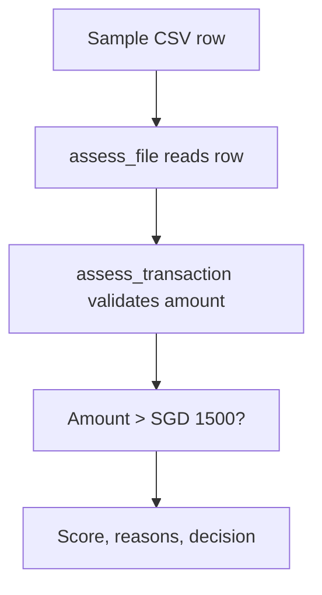

# FraudLens

FraudLens is a **learning project for explainable transaction review**. This first milestone reads fictional payments from a CSV and flags payments above SGD 1,500 for human review. A flag is **not a finding of fraud**.

## Run the first rule

Requires Python 3.10+ and no third-party packages.

```bash
python fraudlens.py
python -m unittest discover -s tests -v
```

The program prints one JSON result per transaction. For example:

```json
{"transaction_id": "TX-103", "score": 1, "reasons": ["amount above SGD 1500"], "decision": "review"}
```

The example CSV has five payments. TX-103 and TX-104 are flagged; TX-102 is exactly SGD 1,500, so it passes. The amount threshold is only a toy rule. High-value payments can be legitimate and smaller payments can be fraudulent.

## Trace one row through the code



1. `data/sample_transactions.csv` contains example payment attributes. The current rule uses only `transaction_id` and `amount_sgd`; other columns are reserved for later rules.
2. `assess_file` reads the CSV with Python's standard library and checks that required columns exist.
3. `assess_transaction` parses money with `Decimal`, rejects invalid or nonpositive amounts, and applies the threshold. It returns a dictionary with a score and explanation.
4. `tests/test_fraudlens.py` checks the threshold boundary, invalid values, and missing CSV columns.

## Build this yourself next

- Change the threshold to SGD 2,000 and predict which sample rows change before running the code.
- Add a second rule for repeated payments from the same account within one hour. This requires ordering by timestamp and looking at earlier transactions only.
- When labelled data is available, compare flags with known outcomes using a confusion matrix, precision and recall. Do not label synthetic fraud using the same rules and then claim a model learned independent patterns.

This version has **no machine learning, real fraud labels, external API, or PayFlow integration**. Those are later milestones after the basic decisions and evaluation are understood.
